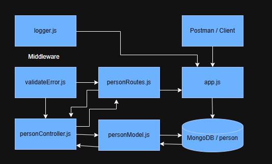

Diagram oversigt

- Overvejlser af sruktur

  MVC-inspireret, 

app.js - Opsætter Express og middleware

logger.js, validateError.js - Logger og validerer requests

personRoutes.js - Bestemmer hvilket endpoint der kaldes

personController.js - Håndterer requests og responses

personModel.js - Definerer datastruktur og bruger Mongoose

MongoDB - Gemmer data

- Hvorfor ikke et service lag?

Ikke nok forretting at skulle lave validering på, personModel bruger required til at bestemme hvad databasen gerne vil modtage, resten tager personController med validateError.

CRUD test med Postman

GET / Person

200

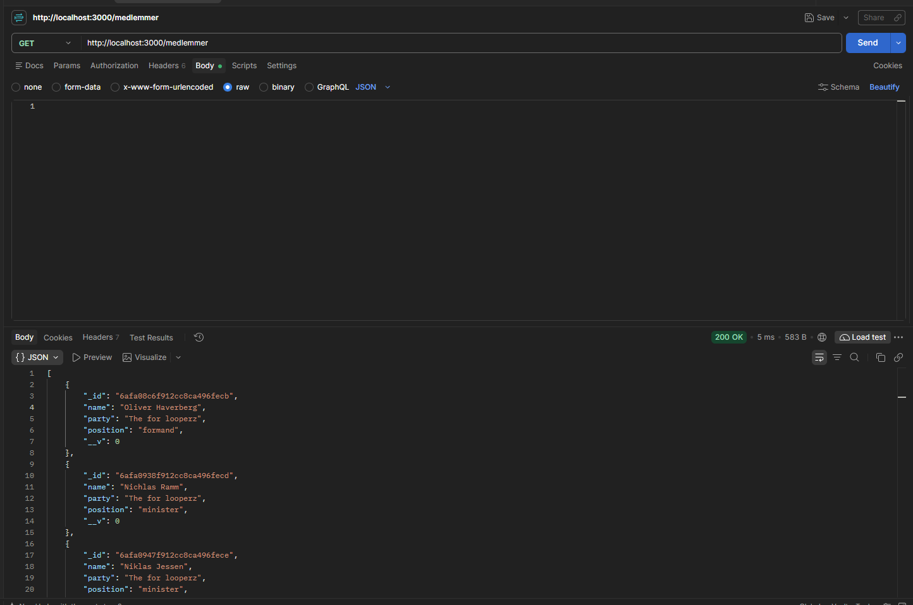

GET / Ministers

200

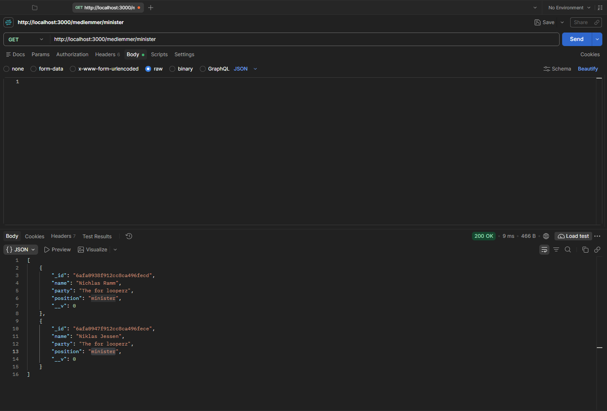

GET / formand

200

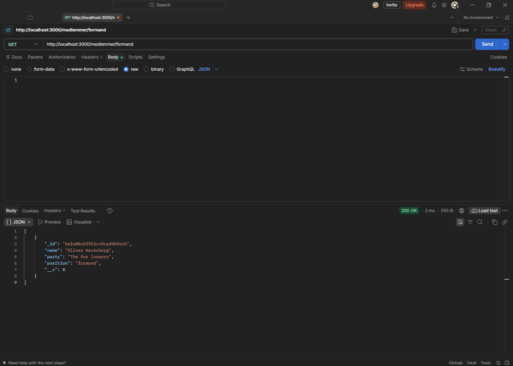

GET / id

200

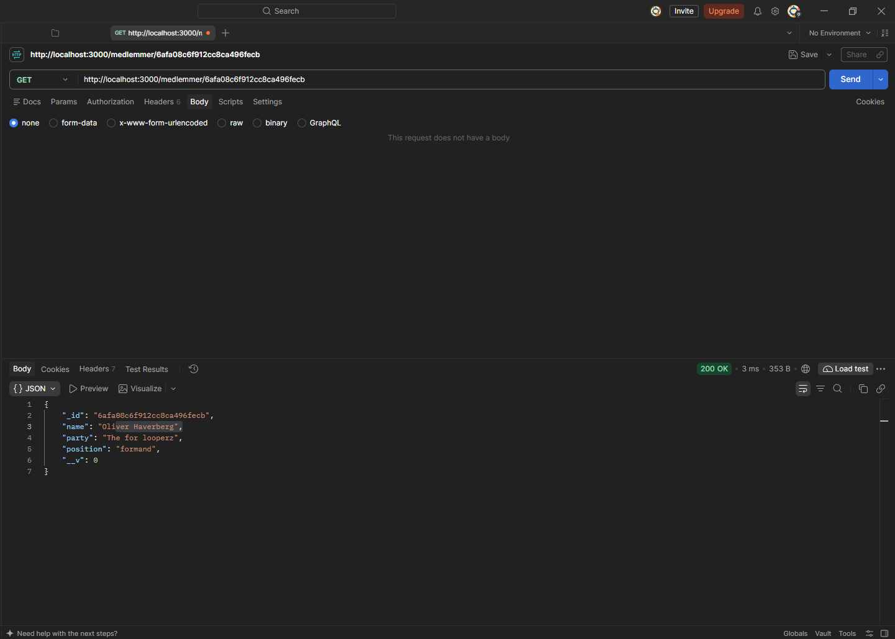

POST / 

400
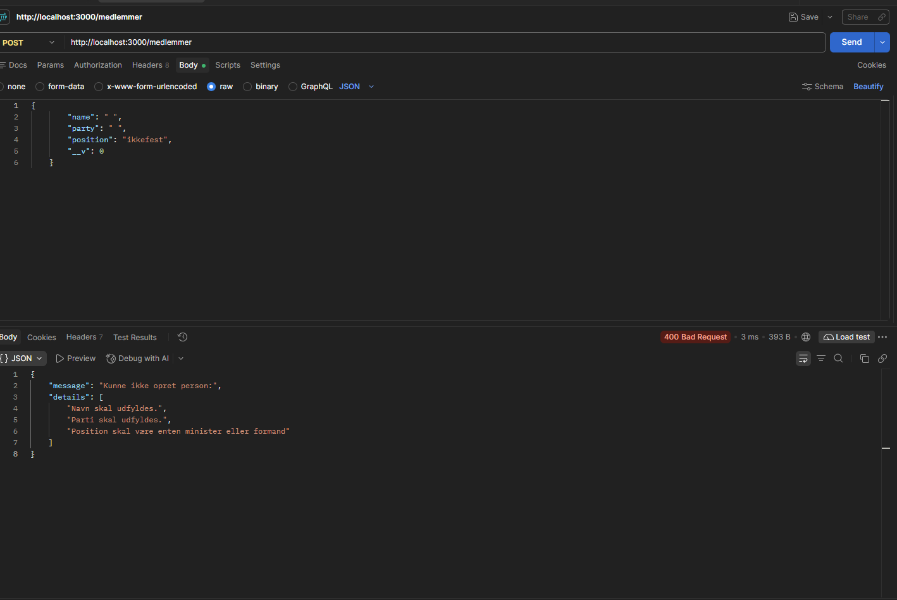

201

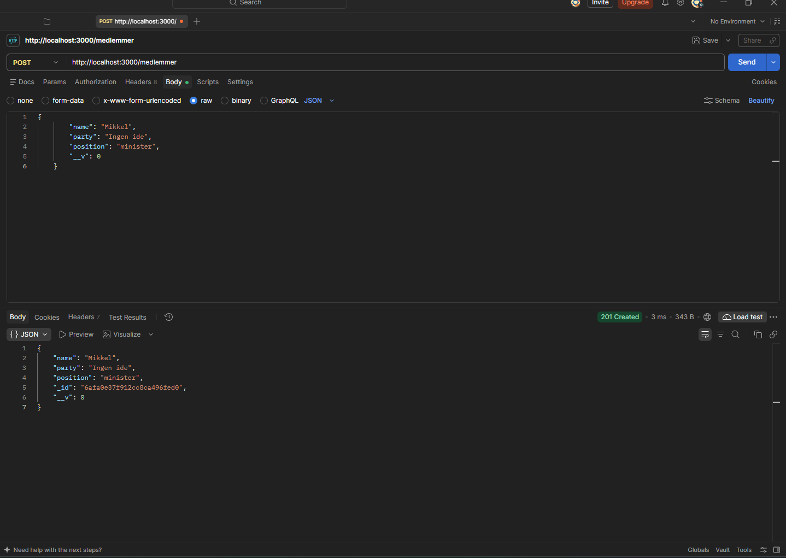

PUT / id

Id ikke findes / 400

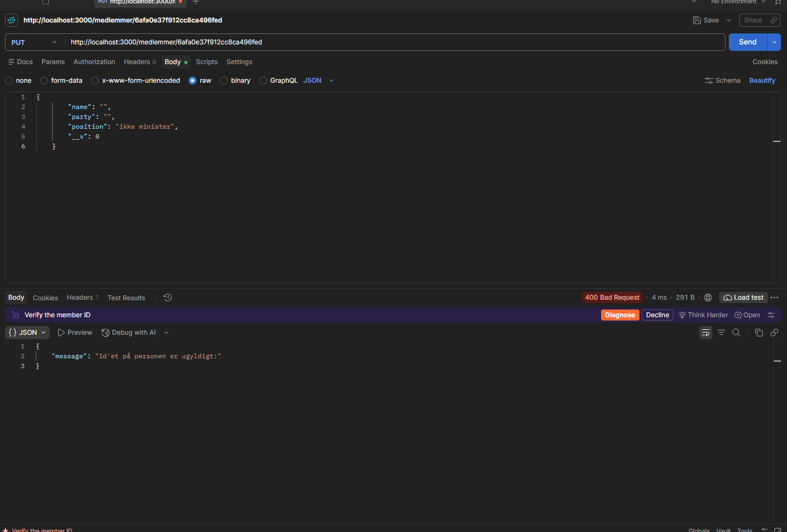

400
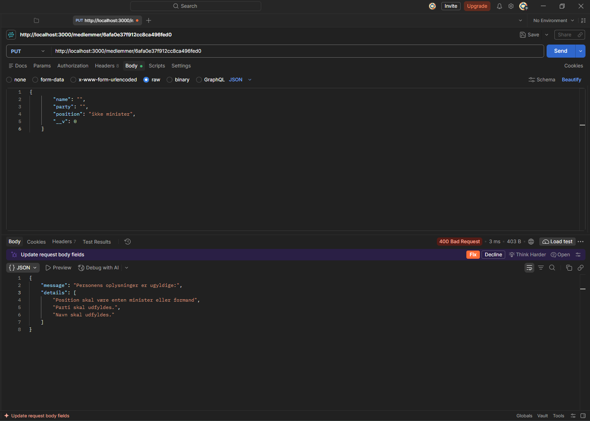

200

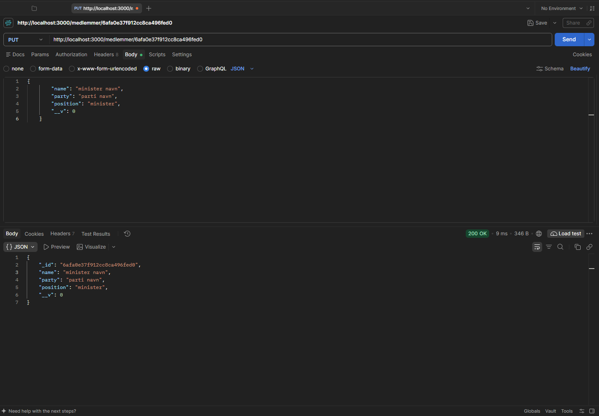

DELETE / id

Id ikke findes / 400

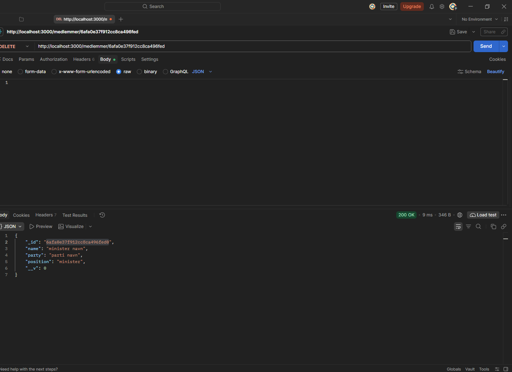

200

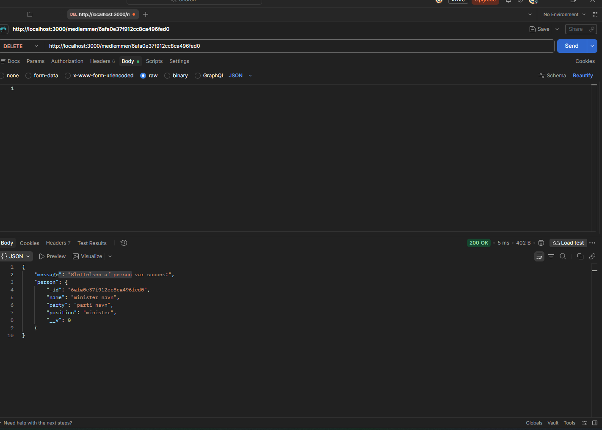

Database

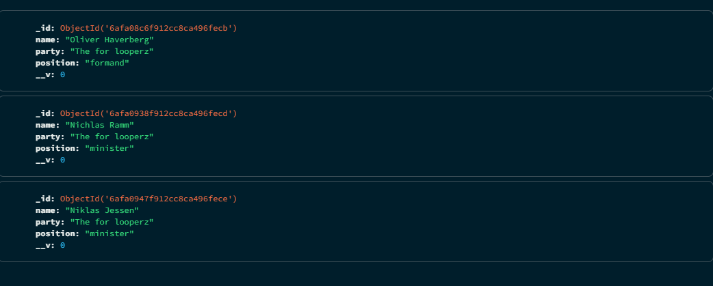

